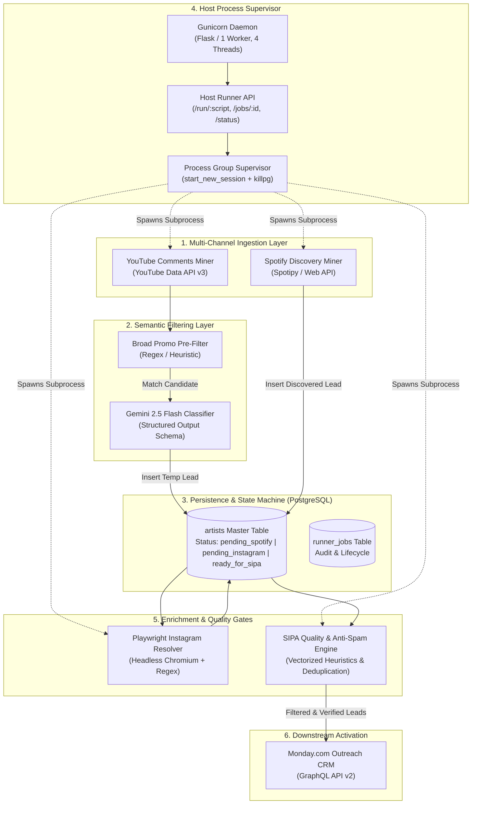

# System Architecture & Technical Design Decisions

This document details the engineering architecture, data pipelines, state machines, and technical design trade-offs governing `beatmatch-ai-automation-hub`.

---

## 1. System Topology & Data Flow

---

## 2. Canonical Reconciliation State Machine

Leads progress through a deterministic, 11-state machine enforced by PostgreSQL constraint `chk_status`, Pydantic v2 `LeadStatus` enum, and `validate_transition()` in `src/reconciler.py`:

```mermaid
stateDiagram-v2
    [*] --> pending_spotify: Discovered via YouTube/Social (Temp SHA-256 ID)
    [*] --> pending_instagram: Discovered via Spotify Catalog (Official Spotify ID)

    pending_spotify --> pending_instagram: Spotify Match (No IG URL yet)
    pending_spotify --> ready_for_sipa: Spotify Match + IG URL present
    pending_spotify --> skipped_no_spotify: No Spotify Match
    pending_spotify --> failed_spotify: Transient Spotify API Error
    failed_spotify --> pending_spotify: Retry Enrichment

    pending_instagram --> ready_for_sipa: Instagram Located & Underground Criteria Met
    pending_instagram --> skipped_no_insta: No Social Profile Found
    pending_instagram --> skipped_too_famous: Exceeds Limits (>8k listeners or >10k views)
    pending_instagram --> failed_instagram: Transient Social/Search Scraping Error
    failed_instagram --> pending_instagram: Retry Enrichment

    ready_for_sipa --> processing: Acquired by Export / Batch Worker
    ready_for_sipa --> garbage: Flagged by SIPA (Spam, Inactive, Duplicate)

    processing --> processed: Successfully Synced to Monday.com CRM
    processing --> ready_for_sipa: Pre-Dispatch Failure (Safe only prior to external API dispatch; ambiguous timeout/network errors retain processing)
    processing --> garbage: Flagged during Batch Cleanse

    skipped_no_spotify --> pending_spotify: Manual Alias/Data Correction
    skipped_no_insta --> pending_instagram: Social Handle Manual Injection

    skipped_too_famous --> [*]: Terminal State
    garbage --> [*]: Terminal State
    processed --> [*]: Terminal State (Outreach Managed)
    processed --> ready_for_sipa: Manual Intervention / Operational Re-export Exception
```

### State Definitions & Classification

| Canonical Status | Category | Description | Terminal? | Next / Retry States |
|---|---|---|---|---|
| `pending_spotify` | Active / Queued | Temporary lead discovered; requires Spotify metadata resolution. | No | `pending_instagram`, `ready_for_sipa`, `skipped_no_spotify`, `failed_spotify`, `garbage` |
| `pending_instagram` | Active / Queued | Valid Spotify entity identified; requires social and underground metric verification. | No | `ready_for_sipa`, `skipped_no_insta`, `skipped_too_famous`, `failed_instagram`, `garbage` |
| `ready_for_sipa` | Active / Qualified | Passed enrichment; ready for SIPA deduplication and CRM dispatch. | No | `processing`, `garbage`, `processed` (direct schema override; standard export worker dispatches via `processing`) |
| `processing` | In-Flight | Locked by dispatch worker during CRM export or batch mutation. | No | `processed`, `ready_for_sipa` (safe only on proven pre-dispatch failure; ambiguous network/timeout errors retain in `processing`), `garbage` |
| `processed` | Completed | Successfully pushed to Monday.com outreach boards. Terminal under standard automated flow. | Yes (Operational override exception) | `ready_for_sipa` (manual intervention / operational re-export exception only) |
| `failed_spotify` | Transient Error | Spotify API rate limit or network timeout. | No | `pending_spotify` (automated retry) |
| `failed_instagram` | Transient Error | Scraping engine or headless browser timeout. | No | `pending_instagram` (automated retry) |
| `skipped_no_spotify` | Filtered | Entity not found in Spotify catalog. | No | `pending_spotify` (manual alias injection) |
| `skipped_no_insta` | Filtered | No matching Instagram account identified. | No | `pending_instagram` (manual handle injection) |
| `skipped_too_famous` | Filtered | Exceeds thresholds (>8k monthly listeners or >10k song streams). | **Yes** | None (terminal) |
| `garbage` | Discarded | Flagged by SIPA as fake profile, bot spam, or duplicate entity. | **Yes** | None (terminal) |

---

## 3. Key Architectural Decisions & Trade-Offs

### Decision 1: Lightweight Host Daemon (`Flask` + `subprocess` + `systemd`) vs. Distributed Queue (`Celery` / `RQ` + `Redis` / `RabbitMQ`)

* **Context:** The pipeline runs scheduled scraping, browser automation (Playwright), and enrichment jobs. The orchestration layer (n8n) runs inside Docker containers.
* **The Problem with Containerized Playwright / Heavy Scrapers:** Running Chromium and heavy data ingestion inside containerized n8n instances caused frequent out-of-memory (OOM) crashes on resource-constrained compute instances (e.g., 4GB RAM).
* **The Problem with Celery + Redis:** Introducing Celery requires maintaining an ephemeral message broker (Redis or RabbitMQ), a result backend, and multiple worker daemons. For a discrete pipeline running 4 to 6 scheduled tasks per day, this adds 300–500MB of resident idle memory and increases operational failure surfaces without business necessity.
* **Chosen Solution:** A native Python supervisor (`src/host_runner.py`) running under Linux `systemd` via Gunicorn.
* **Guarantees Delivered:**
  1. **Strict Process Group Isolation:** Subprocesses are spawned with `start_new_session=True` (`os.setsid`). If a job reaches its timeout threshold, `os.killpg(proc.pid, signal.SIGKILL)` terminates the entire process tree—guaranteeing no orphaned headless Chromium instances consume host memory.
  2. **Race-Condition-Free Slot Reservation:** Concurrent duplicate execution is prevented by an atomic mutex lock (`_active_lock`) that reserves the script slot before launching execution threads, returning HTTP 409 Conflict immediately on collision.
  3. **Persistent Audit Trail:** Job lifecycle events (UUID4, started_at, finished_at, exit_code, status) are persisted directly to PostgreSQL and inspectable via `GET /jobs/<job_id>`.

---

### Decision 2: Two-Tier Semantic Classification (Regex Pre-Filter -> Gemini LLM)

* **Context:** Social video comment sections contain massive volumes of spam, listener reactions, and producer promotions. Calling an LLM API on every raw comment is cost-prohibitive and introduces unnecessary latency.
* **Chosen Architecture:**
  1. **Tier 1 (Regex Pre-Filter):** `BROAD_PROMO_REGEX` screens raw text for music promotional keywords (`"my song"`, `"check my track"`, `"ouça meu som"`). Discards ~80% of non-promotional comments in sub-millisecond CPU time.
  2. **Tier 2 (Gemini 2.5 Flash Evaluation):** Candidates passing Tier 1 are evaluated by Gemini 2.5 Flash using structured JSON schema output (`TalentClassificationResult`). The prompt enforces strict distinction between performing artists (singers, vocalists, rappers) and producers/beatmakers.
* **Workload & Quota Preservation:** Discarding non-promotional text prior to model invocation prevents redundant external network round-trips and preserves provider rate limit allocations, focusing LLM evaluation strictly on candidate promotions that require semantic reasoning.

---

### Decision 3: Strict Parameterized SQL via `psycopg2.sql` and Array Matching

* **Context:** Early iterations of queue filtering used string formatting (f-strings) to assemble SQL update queries and `IN (...)` clauses, introducing potential injection vectors and query plan bloat.
* **Chosen Architecture:**
  1. **Allowlist-Governed Dynamic Updates:** `src/reconciler.py` defines `ALLOWED_ARTIST_UPDATE_COLUMNS`. Any column key not present in the allowlist raises a validation failure and halts execution before touching the database driver. Queries are dynamically composed using `psycopg2.sql.Identifier` and `psycopg2.sql.SQL`.
  2. **Native Array Parameterization:** Batch operations in `src/quality/sipa_cleaner.py` use PostgreSQL's native array operator: `WHERE spotify_id = ANY(%s)`. This avoids runtime placeholder concatenation and allows the PostgreSQL query planner to optimize single-parameter array scans.

---

### Decision 4: Centralized Safe HTTP Client with Mandatory Timeouts and HTTPS

* **Context:** Dispersed integrations (`urllib`, `requests`) across different scraping scripts lacked unified timeouts and scheme validation, risking hanging sockets on dead connections.
* **Chosen Architecture:** `src/utils/http_client.py` centralizes all HTTP interactions.
  1. **Scheme Enforcement:** Rejects non-HTTPS schemes (`http://`, `ftp://`) with a `ValueError`.
  2. **Guaranteed Timeouts:** All calls enforce a default 15-second timeout.
  3. **API Normalization:** Monday.com GraphQL interactions (`query`, `variables`, error extraction) are unified in `call_monday_api()`, eliminating duplicated GraphQL request code.

---

### Decision 5: Conservative Export Recovery & Ambiguous State Preservation (`export_to_monday.py`)

* **Context:** Pushing qualified leads from PostgreSQL (`ready_for_sipa`) to the Monday.com GraphQL API crosses an uncoordinated network boundary without distributed two-phase commit (2PC).
* **The Ambiguity Problem (Two Generals' Problem):** When an HTTP POST request times out (e.g., read socket hang after 15s) or encounters a 5xx/transport error, the remote server might have already created the item. Blindly rolling back the lead to `ready_for_sipa` on every exception causes the next export batch to re-dispatch the lead, creating duplicate board items.
* **Chosen Recovery Policy:**
  1. **Pre-Dispatch Safety:** If payload serialization or column mapping fails *before* dispatching the HTTP call (`_call_api`), no remote mutation could have occurred. The lead is safely reverted to `ready_for_sipa` using atomic Compare-And-Swap (`expected_status="processing"`).
  2. **Ambiguous Failure Retention in `processing`:** When timeouts (`requests.Timeout`), network disconnections (`requests.RequestException`), or unverified GraphQL errors occur during/after dispatch, the outcome is ambiguous. The lead remains in `processing`. It is explicitly **not** reverted to `ready_for_sipa`, preventing duplicate automated re-dispatches.
  3. **Confirmed Creation with Local DB Failure:** If Monday.com returns a valid `item_id` but the local database transaction fails, the lead remains in `processing` and logs the remote ID for manual intervention.
* **Guarantees and Delivery Semantics:**
  - **No Automated Delivery Guarantees:** Without native idempotency keys supported by Monday.com's item creation mutation, neither exactly-once nor automated at-least-once delivery can be guaranteed. The pipeline adopts a conservative duplicate-prevention policy: ambiguous operations are retained in `processing` rather than automatically re-dispatched.
  - **Reconciliation Strategy:** Leads retained in `processing` represent in-flight or ambiguous dispatches. They require operator inspection or explicit manual reconciliation (e.g., verifying Monday.com board items by artist name or ID) rather than automatic unverified re-queueing.
